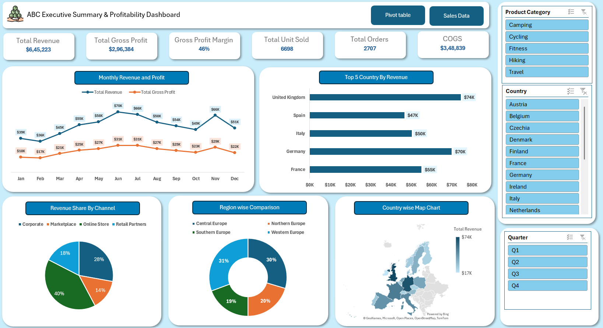

# Excel Sales Dashboard

## Project Overview
An interactive Excel dashboard designed to analyze sales performance, revenue, profitability, and regional trends.

## Objectives
- Track key performance indicators (KPIs).
- Analyze monthly revenue and profit trends.
- Compare sales performance across countries and regions.
- Understand revenue contribution by sales channel.
- Explore performance by product category, country, and quarter.

## Tools & Skills
- Microsoft Excel
- Pivot Tables
- Interactive Slicers
- KPI Cards
- Data Visualization
- Sales Performance Analysis

## Dashboard Features
- Total Revenue
- Total Gross Profit
- Gross Profit Margin
- Total Units Sold
- Total Orders
- Cost of Goods Sold (COGS)
- Monthly Revenue and Profit Trends
- Top 5 Countries by Revenue
- Revenue Share by Channel
- Regional and Country-wise Analysis

## Project Preview

## How to Use
1. Download `Excel Sales Dashboard.xlsx` from this repository.
2. Open the workbook in Microsoft Excel.
3. Use the available slicers to explore sales performance by category, country, and quarter.

## Project Files
- `Excel Sales Dashboard.xlsx` — Interactive Excel dashboard workbook.
- `Excel-Sales-Dashboard.png` — Dashboard preview image.

## Author

Aman Gupta  
Aspiring Data Analyst | Excel & Data Visualization
